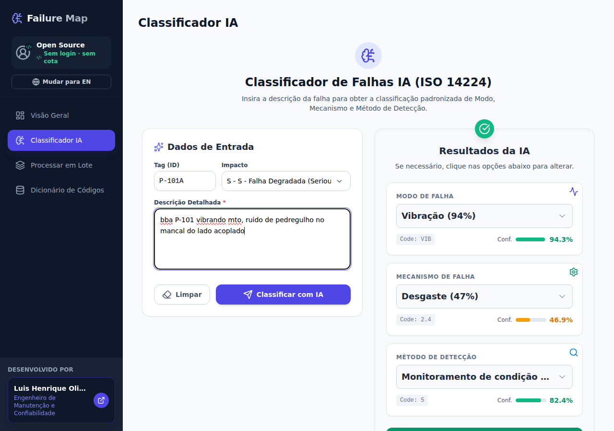

# Failure Map — Classificador de Falhas ISO 14224

[](LICENSE)
[](https://www.python.org/)
[](https://react.dev/)
[](https://fastapi.tiangolo.com/)

Aplicação **open source** que converte notas de manutenção em texto livre ("bba P-101 vibrando mto, ruido de pedregulho") em dados padronizados de falha: **modo**, **mecanismo** e **método de detecção**, com taxonomia baseada na **ISO 14224**.

Uma alternativa determinística ao uso de LLMs para classificar falhas: modelo local, custo zero por inferência, mesma resposta para a mesma entrada e nenhuma chave de API.

Sem login. Sem cota. Sem serviço externo: a classificação roda no seu computador, com o modelo incluído no repositório.



---

## Sumário

- [Sobre o projeto](#sobre-o-projeto)
- [Por que não um LLM?](#por-que-não-um-llm)
- [Sobre mim](#sobre-mim)
- [Funcionalidades](#funcionalidades)
- [Arquitetura](#arquitetura)
- [Como o modelo funciona](#como-o-modelo-funciona)
- [Limitações conhecidas](#limitações-conhecidas)
- [Começando](#começando)
- [Uso](#uso)
- [API REST](#api-rest)
- [Estrutura do repositório](#estrutura-do-repositório)
- [Deploy em servidor](#deploy-em-servidor)
- [Roadmap](#roadmap)
- [Contribuindo](#contribuindo)
- [Segurança](#segurança)
- [Licença](#licença)

---

## Sobre o projeto

Históricos de manutenção são ricos em informação e pobres em estrutura. A causa, o sintoma e a circunstância da falha vivem no texto livre da nota de manutenção ou da ordem de serviço, com gírias regionais, abreviações e erros de digitação. O resultado é conhecido: não dá para agregar, comparar entre ativos nem alimentar indicadores de confiabilidade (MTBF, disponibilidade) com confiança.

O Failure Map ataca essa primeira milha do dado. A partir de uma descrição livre, ele devolve os três códigos mais prováveis em cada eixo da taxonomia ISO 14224, com a confiança de cada sugestão. A revisão humana continua no centro: o resultado vem como **top-3** e a interface permite trocar a sugestão antes de salvar, marcando o registro como `IA` ou `Human`.

O projeto nasceu de um caso de uso real de engenharia de confiabilidade em operação industrial e foi publicado como open source para a comunidade de manutenção — para ser usado, criticado e melhorado.

## Por que não um LLM?

Classificar uma nota de manutenção com um LLM de propósito geral funciona bem na demonstração e mal na conta. Cada chamada custa token, depende de rede, devolve resposta diferente a cada execução e pode inventar um código que não existe na taxonomia. Em uma base com dezenas de milhares de notas isso vira custo recorrente e perda de auditabilidade — e, em confiabilidade, "por que esse código?" precisa ter resposta reproduzível.

O Failure Map segue o caminho oposto: um modelo supervisionado pequeno (TF-IDF + XGBoost), treinado na taxonomia do domínio, que roda localmente e devolve sempre códigos existentes.

| Critério | Failure Map (TF-IDF + XGBoost) | LLM de propósito geral |
| --- | --- | --- |
| Custo por classificação | zero (só CPU) | por token, recorrente |
| Latência | ~6–10 ms por registro (medido) | centenas de ms a segundos, mais rede |
| Determinismo | mesma entrada, mesma saída (`random_state=42`) | varia entre execuções e versões |
| Saída | sempre um código da taxonomia, com probabilidade | pode inventar código ou descrição |
| Offline / privacidade | sim; nada sai da máquina | depende de API e da política do provedor |
| Auditabilidade | pesos versionados, entrada e saída reprodutíveis | caixa-preta que muda quando o provedor atualiza |
| Vocabulário inédito | exige retreino | generaliza sem treino |
| Idiomas | treinado em PT-BR | multilíngue |
| Explicação | top-3 com probabilidade + termos do TF-IDF | texto livre, sem probabilidade calibrada |

A leitura honesta: o LLM ganha quando não existe histórico rotulado, quando o vocabulário muda o tempo todo ou quando o requisito é multilíngue. O modelo supervisionado ganha quando há histórico classificado — o caso de quem faz gestão de ativos — e quando custo, latência e reprodutibilidade pesam. As duas abordagens combinam: usar o LLM para gerar rótulos iniciais e treinar um modelo local para produção é um caminho comum e barato.

## Sobre mim

**Luis Henrique Oliveira** — Engenheiro de Manutenção e Confiabilidade.

Trabalho com gestão de ativos, análise de falhas e confiabilidade em operação industrial. Este projeto nasceu da frustração de ver análises de causa raiz travarem na qualidade do registro, não na competência da equipe.

- LinkedIn: [linkedin.com/in/luishenriqueifma](https://www.linkedin.com/in/luishenriqueifma/)
- E-mail: [luishenrique240@gmail.com](mailto:luishenrique240@gmail.com)

Feedback, crítica técnica e contribuição com bases de falhas são bem-vindos.

## Funcionalidades

- **Classificação individual** — descrição livre → top-3 de modo, mecanismo e método de detecção, com confiança por código.
- **Revisão humana** — cada eixo é um seletor com as 3 alternativas da IA; o registro salvo guarda se houve correção (`Human`) ou não (`IA`).
- **Processamento em lote** — upload de CSV, classificação linha a linha, prévia e exportação do resultado.
- **Dicionário de códigos** — consulta dos códigos das três taxonomias, com busca e descrição PT/EN.
- **Painel** — total de registros, distribuição por impacto, top 5 modos e mecanismos, histórico e exportação CSV.
- **API REST** — FastAPI com documentação automática em `/docs`, sem autenticação, pronta para integrar com CMMS.
- **Bilíngue** — interface em português e inglês (PT/EN).
- **Local-first** — SQLite criado automaticamente; nenhum dado sai da máquina.

## Arquitetura

```
   Nota de campo (texto livre)
             │
             ▼
   ┌───────────────────┐        HTTP/JSON       ┌──────────────────────────┐
   │  Frontend React   │ ────────────────────▶ │  API FastAPI             │
   │  Vite + TS        │ ◀──────────────────── │  (porta 8000)            │
   │  Recharts/i18n    │      top-3 + probs    └────────────┬─────────────┘
   └───────────────────┘                                   │
             │                                             ▼
             │                              ┌──────────────────────────────┐
             │                              │ limpar_texto()               │
             │                              │ minúsculas, sem números,     │
             │                              │ sem pontuação, sem stopwords │
             │                              └──────────────┬───────────────┘
             │                                             ▼
             │                              ┌──────────────────────────────┐
             │                              │ TF-IDF 1.500 termos          │
             │                              │ + One-Hot (Tag, Impacto)     │
             │                              │ = 6.282 features             │
             │                              └──────────────┬───────────────┘
             │                                             ▼
             │                              ┌──────────────────────────────┐
             │                              │ XGBoost ×3                   │
             │                              │ FailMode / FailMech / Det    │
             │                              └──────────────┬───────────────┘
             │                                             ▼
             │                              ┌──────────────────────────────┐
             └──────── histórico ◀────────── │ SQLite (falhas salvas)       │
                                            └──────────────────────────────┘
```

| Camada | Tecnologia |
| --- | --- |
| Frontend | React 19, TypeScript, Vite 6, Recharts, TanStack Query, Tailwind |
| Backend | FastAPI, Pydantic v2, SQLModel |
| ML | scikit-learn 1.6, XGBoost 3.1, pandas, NLTK |
| Persistência | SQLite por padrão (qualquer `DATABASE_URL` SQLAlchemy funciona) |

## Como o modelo funciona

O artefato `modelo_classificacao_falhas.pkl` contém três pipelines independentes, um por eixo da taxonomia, e os `LabelEncoder` correspondentes.

1. **Limpeza** — minúsculas, remoção de dígitos, de pontuação e de stopwords do português (`limpar_texto`). Acentos são preservados, porque o vocabulário foi aprendido com eles.
2. **Vetorização** — TF-IDF com `max_features=1500`, unigramas. O pipeline também aplica one-hot em duas colunas categóricas (`Tag` e `FailureImp`), o que leva o total a **6.282 features**.
3. **Modelagem** — `XGBClassifier` com 100 árvores (`random_state=42`) por eixo. Na inferência, `predict_proba` devolve o top-3 de cada classificador.
4. **Pós-processamento** — código → descrição bilíngue, via dicionários ISO em `api.py` (e espelho em `constants.ts` no front).

| Eixo | Classes no modelo |
| --- | --- |
| Modo de falha (`FailMode`) | 61 |
| Mecanismo de falha (`FailMech`) | 60 |
| Método de detecção (`DetMethod`) | 10 |

Os números de desempenho relatados no trabalho técnico (86% / 85% / 83% de acurácia para modo, mecanismo e detecção) **não são reproduzíveis a partir deste repositório**, porque a base de treino não é distribuída. `GET /model-info` expõe a configuração real do artefato publicado.

## Limitações conhecidas

Transparência vale mais que marketing. O que está publicado tem limites que você deve conhecer antes de usar:

- **A base de treino não acompanha o repositório.** Só o modelo treinado. Portanto não há como recalcular as métricas do artigo a partir daqui.
- **Taxonomia de mecanismo maior que a Tabela B.2.** O modelo prevê 60 classes; a Tabela B.2 (edição 2006) tem 32 subcódigos (+6 categorias gerais). Parte das classes extras vem das subdivisões da edição 2016 (1.7–1.15, 2.9–2.17, 2.21); outras (4.6, 5.4–5.9, 6.5) não são códigos ISO.
- **Três códigos da tabela não são previstos:** 1.10, 2.10 (trinca) e 2.20 (CUI). O padrão sugere que esses rótulos foram lidos como número durante a preparação dos dados (1.10 → 1.1, 2.10 → 2.1, 2.20 → 2.2), o que contamina o rótulo original. Também existe uma classe `11.0` sem correspondência ISO.
- **O campo "Impacto" influencia muito.** Com impacto `X` ("Outros"), o modelo tende a responder `OTH` (Outro) para quase qualquer texto — o campo parece ter funcionado como atalho no treino. O formulário já vem com `S` por padrão; se for integrar via API, não envie `X` sem saber disso.
- **Sensibilidade a acentos.** "vibração alta no mancal" e "vibracao alta no mancal" podem cair em classes diferentes. Numa amostra de 40 notas, remover acentos mudou o top-1 em 30% dos casos (modo) e 40% (mecanismo). A correção exige retreinar com texto normalizado — não basta mexer na inferência.
- **`Tag` tem 4.778 níveis e ~0,04% de importância.** Praticamente não ajuda e infla o vetor. Também espera o formato visto no treino; uma tag de campo comum (`P-101`) cai como categoria desconhecida e é ignorada.
- **SMOTE não é verificável.** Não há `imblearn` no `requirements.txt` nem script de treino no repositório. Se o balanceamento foi usado, ele não está documentado no artefato.
- **Tailwind via CDN.** O `index.html` usa o CDN do Tailwind (aviso no console, dependência de internet). Migrar para build local está no roadmap.

## Começando

### Pré-requisitos

- Python 3.10+
- Node.js 18+ (testado com Node 26)
- ~250 MB de disco (o `.pkl` tem 16 MB; as dependências ocupam o resto)

O código da aplicação fica em `Classificador-de-Falhas-main/` (herança do export original). Os caminhos abaixo já consideram isso.

### Atalho com Make (opcional)

```bash
make setup    # cria a venv, instala as dependências e baixa as stopwords + npm install
make api      # API em http://localhost:8000
make web      # frontend em http://localhost:5173  (em outro terminal)
```

Se preferir o passo a passo (ou não tiver `make`), siga as seções abaixo.

### Backend

```bash
cd Classificador-de-Falhas-main/Backend

python3 -m venv venv
source venv/bin/activate            # Windows: venv\Scripts\activate
pip install -r requirements.txt
python -m nltk.downloader stopwords

# Sobe a API em http://localhost:8000
uvicorn api:app --reload --port 8000
```

O banco SQLite (`failuremap.db`) é criado sozinho no primeiro uso. Se `DATABASE_URL` não for definida, é isso que acontece.

Verificação rápida:

```bash
curl http://localhost:8000/health
# {"status":"ok","model_loaded":true}

curl -X POST http://localhost:8000/classificar \
  -H "Content-Type: application/json" \
  -d '{"tag":"P-101","descricao":"bba P-101 vibrando mto, ruido de pedregulho","impacto":"S"}'
```

### Frontend

```bash
cd Classificador-de-Falhas-main/Frontend
npm install

# aponta para a API local
echo "VITE_API_URL=http://localhost:8000" > .env

npm run dev      # http://localhost:5173
```

Build de produção:

```bash
npm run build    # gera dist/
npm run preview
```

### Docker (somente backend)

```bash
cd Classificador-de-Falhas-main/Backend
docker build -t failure-map-api .
docker run --rm -p 8000:8000 -v "$PWD/data:/app/data" failure-map-api
```

### Variáveis de ambiente

| Variável | Onde | Padrão | Descrição |
| --- | --- | --- | --- |
| `VITE_API_URL` | Frontend | `http://localhost:8000` | URL base da API |
| `DATABASE_URL` | Backend | `sqlite:///./failuremap.db` | Qualquer URL SQLAlchemy |
| `ALLOWED_ORIGINS` | Backend | `*` | Origens CORS, separadas por vírgula |
| `RATE_LIMIT_PER_MIN` | Backend | `60` | Requisições/minuto por IP nas rotas de escrita e inferência (`0` desativa) |

## Uso

### Interface

1. **Classificador IA** — preencha a descrição (e, se quiser, a tag e o impacto) e clique em *Classificar com IA*. Ajuste o top-3 se discordar e salve.
2. **Processar em Lote** — envie um CSV com as colunas `tag,descricao,impacto` (cabeçalho obrigatório, separador `,` ou `;`), acompanhe o progresso e baixe o resultado.
3. **Dicionário de Códigos** — consulte os códigos e descrições das três taxonomias.
4. **Visão Geral** — painel com o histórico salvo, gráficos e exportação CSV.

Exemplo de CSV para lote:

```csv
tag,descricao,impacto
P-101A,"vibração excessiva no mancal, ruído anormal",S
V-204,"vazamento de óleo pelo selo mecânico",D
M-310,"motor superaquecendo após partida",U
```

### Chamada direta da API

```bash
curl -X POST http://localhost:8000/classificar \
  -H "Content-Type: application/json" \
  -d '{
        "tag": "P-101A",
        "descricao": "vibração excessiva no mancal do lado acoplado, com ruído anormal",
        "impacto": "S"
      }'
```

## API REST

Documentação interativa: `http://localhost:8000/docs`.

| Método | Rota | Descrição |
| --- | --- | --- |
| `GET` | `/` | Identificação do serviço |
| `GET` | `/health` | Status e se o modelo carregou |
| `GET` | `/model-info` | Classes, features e hiperparâmetros do artefato |
| `POST` | `/classificar` | Top-3 por eixo a partir do texto livre |
| `POST` | `/save-record` | Salva uma classificação revisada |
| `POST` | `/save-batch-records` | Salva um lote |
| `GET` | `/history?limit=50` | Últimos registros salvos (1–500) |

Exemplo de resposta de `/classificar`:

```json
{
  "modo": [
    {"codigo": "VIB", "descricao": "Vibration (Vibração)", "confianca": 0.929},
    {"codigo": "STD", "descricao": "Structural Deficiency", "confianca": 0.021},
    {"codigo": "PDE", "descricao": "Parameter deviation", "confianca": 0.004}
  ],
  "mecanismo": [
    {"codigo": "2.4", "descricao": "Wear (Desgaste)", "confianca": 0.415}
  ],
  "deteccao": [
    {"codigo": "5", "descricao": "Continuous condition monitoring", "confianca": 0.824}
  ],
  "texto_processado": "bba vibrando mto ruido pedregulho"
}
```

> Os campos `modo`, `mecanismo` e `deteccao` trazem sempre 3 itens; o exemplo acima está abreviado.

## Estrutura do repositório

```
Classificador-de-Falhas/
├── README.md
├── LICENSE
├── CONTRIBUTING.md
├── Classificador-de-Falhas-main/
│   ├── Backend/
│   │   ├── api.py                          # API FastAPI (endpoints, taxonomia, limpeza)
│   │   ├── modelo_classificacao_falhas.pkl # modelo treinado (16 MB)
│   │   ├── requirements.txt
│   │   ├── Dockerfile
│   │   └── failuremap.db                   # criado em runtime (não versionado)
│   └── Frontend/
│       ├── App.tsx, index.tsx, types.ts, constants.ts
│       ├── components/                     # Classifier, BatchProcessor, Dashboard, Dictionary...
│       ├── services/aiService.ts           # cliente HTTP da API
│       ├── contexts/LanguageContext.tsx    # i18n PT/EN
│       └── vite.config.ts
└── docs/
    └── screenshot.png
```

## Deploy em servidor

Exemplo de Nginx servindo o build e encaminhando a API (mesmo domínio, sem CORS):

```nginx
server {
    listen 80;
    server_name failuremap.exemplo.com;
    root /var/www/failuremap;
    index index.html;

    location /api/ {
        rewrite ^/api/(.*) /$1 break;
        proxy_pass http://127.0.0.1:8000;
        proxy_set_header Host $host;
        proxy_set_header X-Forwarded-For $proxy_add_x_forwarded_for;
    }

    location / {
        try_files $uri $uri/ /index.html;
    }
}
```

Build correspondente:

```bash
VITE_API_URL=/api npm run build -- --base=/
rsync -a --delete dist/ /var/www/failuremap/
```

O backend roda como serviço (`uvicorn api:app --host 0.0.0.0 --port 8000`), com `DATABASE_URL` apontando para onde você quer persistir.

## Roadmap

- [ ] Retreinar com normalização de acentos e comparar o efeito nas métricas.
- [ ] Colapsar o mecanismo na Tabela B.2 (32 códigos) e publicar as duas versões.
- [ ] Investigar a fusão 1.10/2.10/2.20 e a classe 11.0.
- [ ] Remover `Tag` e `Impacto` do modelo (ablação) e medir a diferença.
- [ ] Substituir o Tailwind CDN por build local.
- [ ] Testes automatizados do backend (`pytest`) e do frontend (`vitest`).
- [ ] Suporte a inglês no texto de entrada (hoje o modelo é treinado em PT-BR).
- [ ] Exportação para CMMS (SAP PM, Maximo) direto da fila de revisão.

## Contribuindo

Contribuições são bem-vindas — código, crítica metodológica, bases de falhas anonimizadas e correções de taxonomia. Leia o [CONTRIBUTING.md](CONTRIBUTING.md) antes de abrir um PR.

Para reportar problema de classificação, o ideal é enviar: descrição usada, impacto selecionado, o que o modelo respondeu e o que você esperava (com o código ISO).

## Segurança

Esta aplicação **não tem autenticação por design**: quem alcança a porta da API pode classificar e gravar. Para uso local isso é conveniente; para instância pública, exige cuidado.

O que já está implementado: validação de entrada com limites de tamanho, limite de 60 requisições/minuto por IP nas rotas de inferência e escrita, CORS configurável, SQL parametrizado, container sem root e recomendações de bind em `127.0.0.1` atrás de proxy.

O modelo de ameaça completo, o checklist de hospedagem, a política de privacidade/LGPD e o resultado da varredura de segredos estão em [SECURITY.md](SECURITY.md).

Para reportar vulnerabilidade: [luishenrique240@gmail.com](mailto:luishenrique240@gmail.com), assunto `[SECURITY] Failure Map`.

## Licença

[MIT](LICENSE) © 2026 Luis Henrique Oliveira.

A licença cobre o código. O modelo treinado (`modelo_classificacao_falhas.pkl`) é distribuído como parte do projeto para que a aplicação funcione de imediato; a base de treino não é distribuída. Se você pretende usar o modelo comercialmente, avalie com cuidado a origem dos dados que o alimentaram.

---

Feito para a comunidade de manutenção e confiabilidade. Se este projeto te ajudar, conte como foi — e mande as falhas que ele errou.
