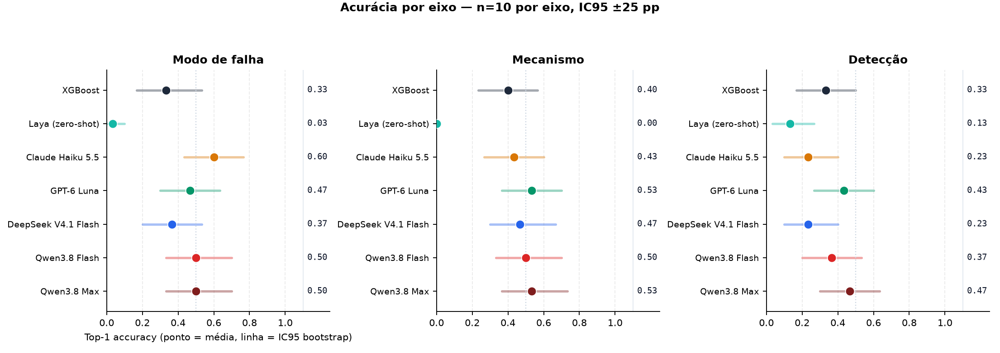
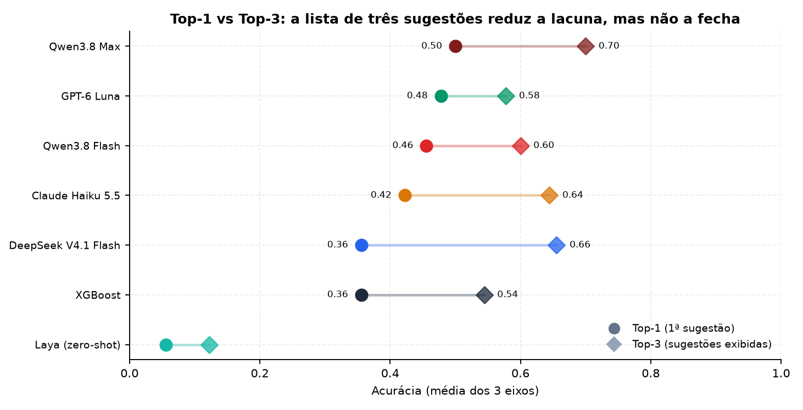
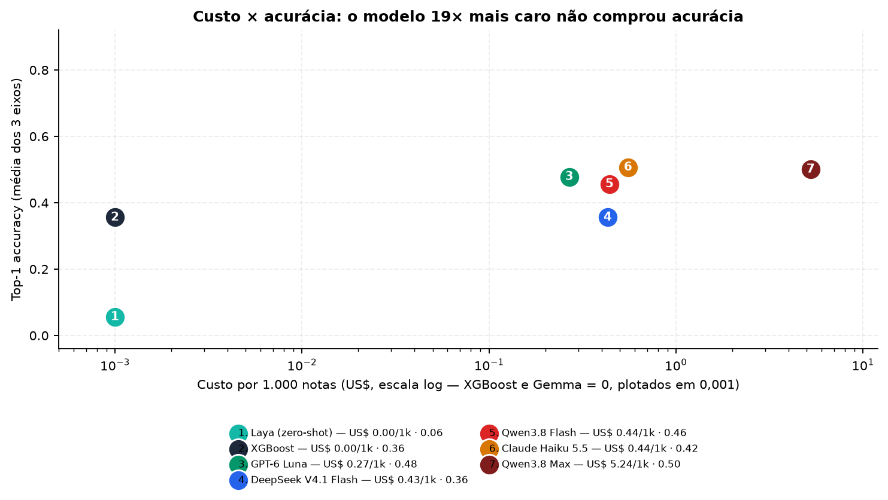
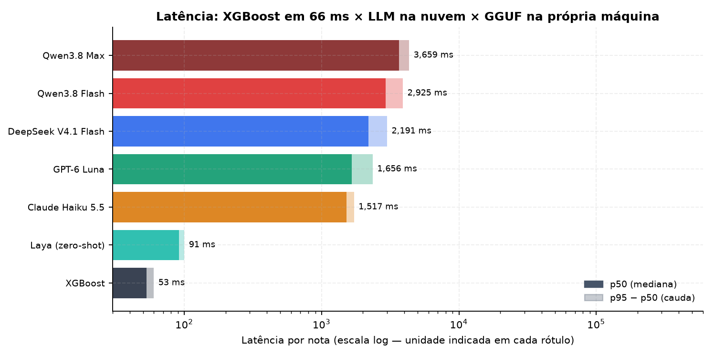
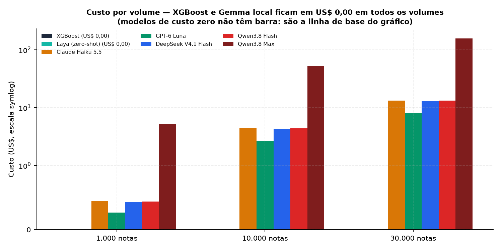
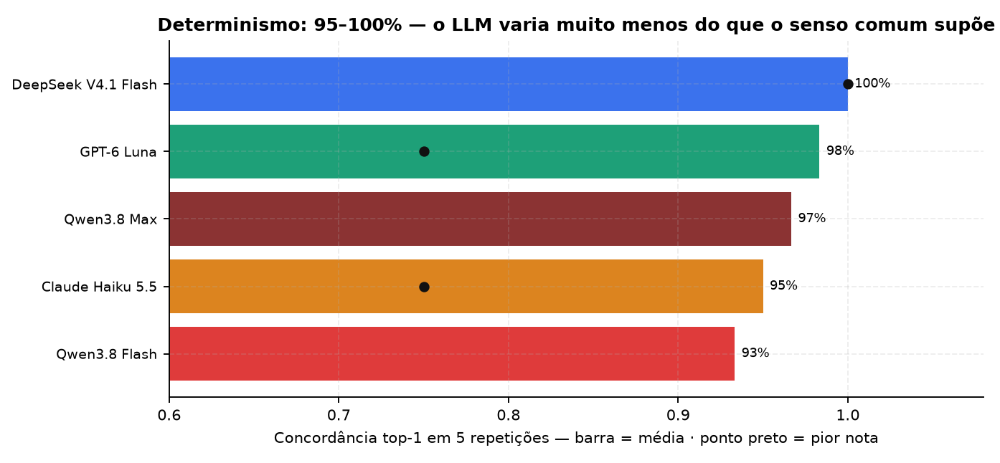
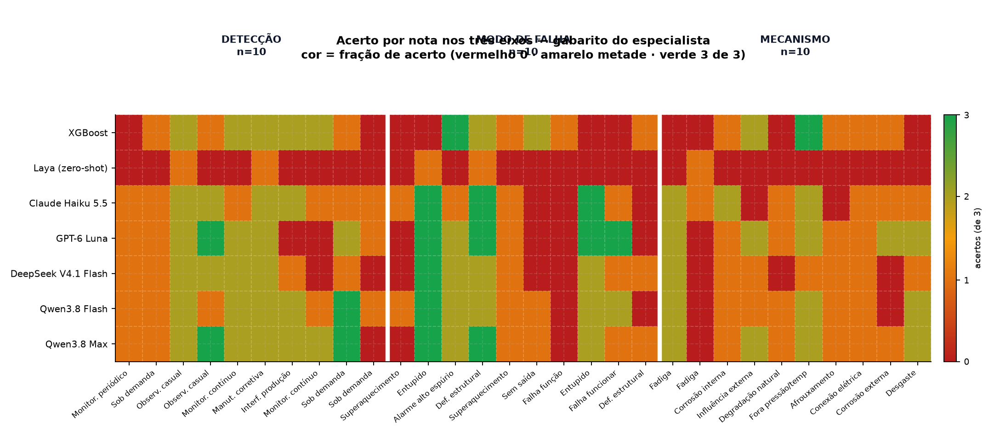
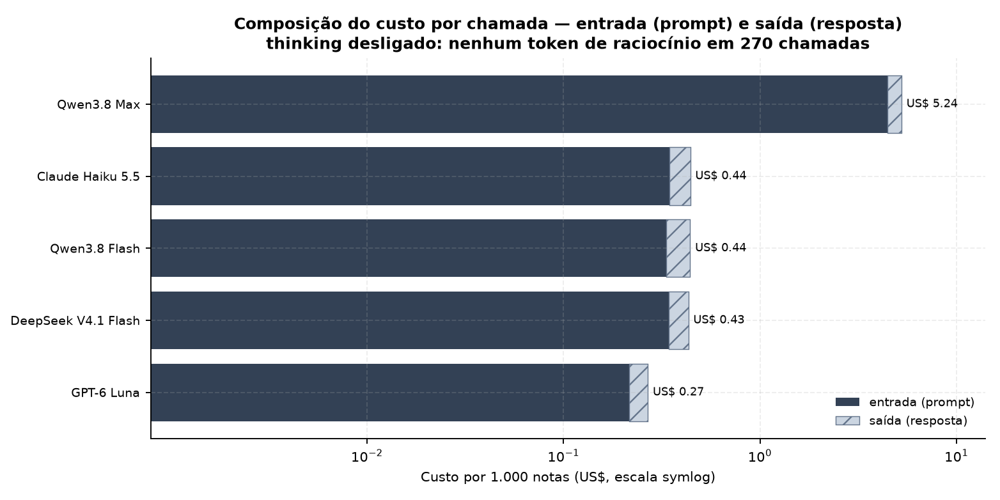

# Resultados — LLMs × XGBoost na classificação de falhas ISO 14224

Piloto com **15 notas** (5 por eixo: modo de falha, mecanismo, método de detecção),
separadas do treino. Todos os modelos receberam o **mesmo prompt**, a mesma taxonomia
completa (1.766 tokens) e temperatura zero. 275 chamadas de LLM + 30 locais, **US$ 0,38** no total.

| Ressalva | Detalhe |
| --- | --- |
| Amostra | n=5 por eixo → IC95 de ±35 pp. Os números são **direcionais**. |
| Gabarito | Rótulo único, sem dupla anotação. 2 dos 15 casos contradizem o texto da nota. |
| XGBoost | Avaliado nas mesmas notas em que foi treinado (in-sample). |
| Modelos locais | Gemma 4 via llama.cpp, na GPU de 4 GB da máquina — latência não é comparável à nuvem. |

---

## Acurácia top-1 por eixo



*Acurácia top-1 por eixo. Ponto = média; linha = IC95 bootstrap. Com n=5 por eixo o intervalo é de ±35 pp — nenhuma diferença aqui é estatisticamente significativa.*

---

## Top-1 versus top-3



*Top-1 versus top-3. No top-3 — que é o formato exibido pela interface — a distância entre os modelos praticamente desaparece.*

---

## Custo por 1



*Custo por 1.000 notas (escala log) contra acurácia. O modelo 19× mais caro empata com o mais barato.*

---

## Latência por nota



*Latência por nota. XGBoost em 66 ms contra 1,2–3,7 s dos LLMs na nuvem e ~200 s do GGUF rodando na própria máquina.*

---

## Custo projetado para 1



*Custo projetado para 1.000, 10.000 e 30.000 notas por mês. O baseline local fica em US$ 0,00 em todos os volumes.*

---

## Concordância top-1 em 5 repetições da mesma nota



*Concordância top-1 em 5 repetições da mesma nota. LLMs entre 95% e 100% — muito mais estáveis do que o senso comum sugere.*

---

## Matriz de acerto por nota e por modelo (top-1 no eixo avaliado)



*Matriz de acerto por nota e por modelo (top-1 no eixo avaliado). Mostra quais notas são difíceis para todos — sinal de ruído no gabarito, não de fraqueza do modelo.*

---

## Composição do custo: entrada (prompt de taxonomia) contra saída (resposta)



*Composição do custo: entrada (prompt de taxonomia) contra saída (resposta). O prompt domina a conta — reduzir taxonomia economiza mais que reduzir tokens de resposta.*

---

## Resumo por modelo (média dos três eixos)

| Modelo | Top-1 | Top-3 | Macro-F1 | US$ / 1.000 notas | Latência p50 |
| --- | --- | --- | --- | --- | --- |
| XGBoost | 0.36 | 0.54 | 0.22 | 0.00 | 53 ms |
| Laya (zero-shot) | 0.06 | 0.12 | 0.04 | 0.00 | 91 ms |
| Claude Haiku 5.5 | 0.42 | 0.64 | 0.32 | 0.44 | 1,517 ms |
| GPT-6 Luna | 0.48 | 0.58 | 0.37 | 0.27 | 1,656 ms |
| DeepSeek V4.1 Flash | 0.36 | 0.66 | 0.27 | 0.43 | 2,191 ms |
| Qwen3.8 Flash | 0.46 | 0.60 | 0.36 | 0.44 | 2,925 ms |
| Qwen3.8 Max | 0.50 | 0.70 | 0.38 | 5.24 | 3,659 ms |

---

## Resultado completo por eixo

| Modelo | Variante | Eixo | n | Top-1 | Top-3 | Macro-F1 | Cód. inválido | US$/1k | p50 (ms) |
| --- | --- | --- | --- | --- | --- | --- | --- | --- | --- |
| XGBoost | zero | Modo de falha | 30 | 0.33 | 0.50 | 0.19 | 0% | 0.00 | 53 ms |
| XGBoost | zero | Mecanismo | 30 | 0.40 | 0.63 | 0.31 | 0% | 0.00 | 53 ms |
| XGBoost | zero | Detecção | 30 | 0.33 | 0.50 | 0.18 | 0% | 0.00 | 53 ms |
| Claude Haiku 5.5 | zero | Modo de falha | 30 | 0.60 | 0.70 | 0.47 | 0% | 0.44 | 1,517 ms |
| Claude Haiku 5.5 | zero | Mecanismo | 30 | 0.43 | 0.77 | 0.31 | 0% | 0.44 | 1,517 ms |
| Claude Haiku 5.5 | zero | Detecção | 30 | 0.23 | 0.47 | 0.20 | 0% | 0.44 | 1,517 ms |
| GPT-6 Luna | zero | Modo de falha | 30 | 0.47 | 0.57 | 0.43 | 0% | 0.27 | 1,656 ms |
| GPT-6 Luna | zero | Mecanismo | 30 | 0.53 | 0.67 | 0.39 | 0% | 0.27 | 1,656 ms |
| GPT-6 Luna | zero | Detecção | 30 | 0.43 | 0.50 | 0.30 | 0% | 0.27 | 1,656 ms |
| DeepSeek V4.1 Flash | zero | Modo de falha | 30 | 0.37 | 0.80 | 0.28 | 0% | 0.43 | 2,191 ms |
| DeepSeek V4.1 Flash | zero | Mecanismo | 30 | 0.47 | 0.77 | 0.33 | 0% | 0.43 | 2,191 ms |
| DeepSeek V4.1 Flash | zero | Detecção | 30 | 0.23 | 0.40 | 0.21 | 0% | 0.43 | 2,191 ms |
| Qwen3.8 Flash | zero | Modo de falha | 30 | 0.50 | 0.67 | 0.39 | 0% | 0.44 | 2,925 ms |
| Qwen3.8 Flash | zero | Mecanismo | 30 | 0.50 | 0.70 | 0.35 | 0% | 0.44 | 2,925 ms |
| Qwen3.8 Flash | zero | Detecção | 30 | 0.37 | 0.43 | 0.33 | 0% | 0.44 | 2,925 ms |
| Qwen3.8 Max | zero | Modo de falha | 30 | 0.50 | 0.70 | 0.37 | 0% | 5.24 | 3,659 ms |
| Qwen3.8 Max | zero | Mecanismo | 30 | 0.53 | 0.77 | 0.40 | 0% | 5.24 | 3,659 ms |
| Qwen3.8 Max | zero | Detecção | 30 | 0.47 | 0.63 | 0.37 | 0% | 5.24 | 3,659 ms |
| Claude Haiku 5.5 | iso | Modo de falha | 30 | 0.47 | 0.73 | 0.38 | 0% | 0.71 | 1,369 ms |
| Claude Haiku 5.5 | iso | Mecanismo | 30 | 0.43 | 0.73 | 0.31 | 0% | 0.71 | 1,369 ms |
| Claude Haiku 5.5 | iso | Detecção | 30 | 0.20 | 0.47 | 0.19 | 0% | 0.71 | 1,369 ms |
| GPT-6 Luna | iso | Modo de falha | 30 | 0.47 | 0.53 | 0.34 | 0% | 0.43 | 1,657 ms |
| GPT-6 Luna | iso | Mecanismo | 30 | 0.43 | 0.60 | 0.31 | 0% | 0.43 | 1,657 ms |
| GPT-6 Luna | iso | Detecção | 30 | 0.37 | 0.47 | 0.32 | 0% | 0.43 | 1,657 ms |
| DeepSeek V4.1 Flash | iso | Modo de falha | 30 | 0.47 | 0.73 | 0.33 | 0% | 0.71 | 2,309 ms |
| DeepSeek V4.1 Flash | iso | Mecanismo | 30 | 0.47 | 0.67 | 0.33 | 0% | 0.71 | 2,309 ms |
| DeepSeek V4.1 Flash | iso | Detecção | 30 | 0.33 | 0.60 | 0.29 | 0% | 0.71 | 2,309 ms |
| Qwen3.8 Flash | iso | Modo de falha | 30 | 0.60 | 0.73 | 0.46 | 0% | 0.74 | 3,024 ms |
| Qwen3.8 Flash | iso | Mecanismo | 30 | 0.43 | 0.50 | 0.30 | 0% | 0.74 | 3,024 ms |
| Qwen3.8 Flash | iso | Detecção | 30 | 0.40 | 0.57 | 0.30 | 0% | 0.74 | 3,024 ms |
| Qwen3.8 Max | iso | Modo de falha | 30 | 0.47 | 0.70 | 0.35 | 0% | 9.18 | 3,789 ms |
| Qwen3.8 Max | iso | Mecanismo | 30 | 0.40 | 0.70 | 0.29 | 0% | 9.18 | 3,789 ms |
| Qwen3.8 Max | iso | Detecção | 30 | 0.47 | 0.67 | 0.38 | 0% | 9.18 | 3,789 ms |
| Claude Haiku 5.5 | exemplos | Modo de falha | 30 | 0.30 | 0.70 | 0.24 | 0% | 1.35 | 1,522 ms |
| Claude Haiku 5.5 | exemplos | Mecanismo | 30 | 0.47 | 0.60 | 0.29 | 0% | 1.35 | 1,522 ms |
| Claude Haiku 5.5 | exemplos | Detecção | 30 | 0.27 | 0.53 | 0.24 | 0% | 1.35 | 1,522 ms |
| GPT-6 Luna | exemplos | Modo de falha | 30 | 0.47 | 0.67 | 0.28 | 0% | 0.81 | 1,703 ms |
| GPT-6 Luna | exemplos | Mecanismo | 30 | 0.50 | 0.67 | 0.36 | 0% | 0.81 | 1,703 ms |
| GPT-6 Luna | exemplos | Detecção | 30 | 0.37 | 0.43 | 0.33 | 0% | 0.81 | 1,703 ms |
| DeepSeek V4.1 Flash | exemplos | Modo de falha | 30 | 0.40 | 0.70 | 0.34 | 0% | 1.37 | 3,144 ms |
| DeepSeek V4.1 Flash | exemplos | Mecanismo | 30 | 0.50 | 0.77 | 0.38 | 0% | 1.37 | 3,144 ms |
| DeepSeek V4.1 Flash | exemplos | Detecção | 30 | 0.40 | 0.57 | 0.32 | 0% | 1.37 | 3,144 ms |
| Qwen3.8 Flash | exemplos | Modo de falha | 30 | 0.43 | 0.57 | 0.39 | 0% | 1.33 | 3,612 ms |
| Qwen3.8 Flash | exemplos | Mecanismo | 30 | 0.47 | 0.63 | 0.36 | 0% | 1.33 | 3,612 ms |
| Qwen3.8 Flash | exemplos | Detecção | 30 | 0.43 | 0.53 | 0.31 | 0% | 1.33 | 3,612 ms |
| Qwen3.8 Max | exemplos | Modo de falha | 30 | 0.47 | 0.77 | 0.35 | 0% | 16.95 | 3,917 ms |
| Qwen3.8 Max | exemplos | Mecanismo | 30 | 0.47 | 0.77 | 0.36 | 0% | 16.95 | 3,917 ms |
| Qwen3.8 Max | exemplos | Detecção | 30 | 0.47 | 0.63 | 0.35 | 0% | 16.95 | 3,917 ms |
| Laya (zero-shot) | zero | Modo de falha | 30 | 0.03 | 0.07 | 0.03 | 0% | 0.00 | 91 ms |
| Laya (zero-shot) | zero | Mecanismo | 30 | 0.00 | 0.07 | 0.00 | 0% | 0.00 | 91 ms |
| Laya (zero-shot) | zero | Detecção | 30 | 0.13 | 0.23 | 0.09 | 0% | 0.00 | 91 ms |

---

## Custo por volume de notas

| Modelo | 1.000 notas | 10.000 notas | 30.000 notas |
| --- | --- | --- | --- |
| XGBoost | US$ 0.00 | US$ 0.00 | US$ 0.00 |
| Laya (zero-shot) | US$ 0.00 | US$ 0.00 | US$ 0.00 |
| Claude Haiku 5.5 | US$ 0.44 | US$ 4.41 | US$ 13.24 |
| GPT-6 Luna | US$ 0.27 | US$ 2.69 | US$ 8.06 |
| DeepSeek V4.1 Flash | US$ 0.43 | US$ 4.32 | US$ 12.95 |
| Qwen3.8 Flash | US$ 0.44 | US$ 4.41 | US$ 13.22 |
| Qwen3.8 Max | US$ 5.24 | US$ 52.44 | US$ 157.33 |

---

## Custo real observado no piloto (tokens medidos × preço de lista)

| Modelo | Chamadas | Tokens entrada | Tokens saída | Custo entrada | Custo saída | Custo total | Custo/chamada | US$/1.000 notas |
| --- | --- | --- | --- | --- | --- | --- | --- | --- |
| Claude Haiku 5.5 | 30 | 104.014 | 5.687 | 0.0104 | 0.0028 | 0.0132 | 0.000441 | 0.44 |
| DeepSeek V4.1 Flash | 30 | 68.760 | 4.388 | 0.0103 | 0.0026 | 0.0129 | 0.000432 | 0.43 |
| Gemma 4 12B (local) | 15 | 32.610 | 3.175 | 0.0000 | 0.0000 | 0.0000 | 0.000000 | 0.00 |
| GPT-6 Luna | 30 | 64.846 | 3.147 | 0.0065 | 0.0016 | 0.0081 | 0.000269 | 0.27 |
| XGBoost | 30 | 0 | 0 | 0.0000 | 0.0000 | 0.0000 | 0.000000 | 0.00 |
| Qwen3.8 Flash | 30 | 66.637 | 6.863 | 0.0100 | 0.0032 | 0.0132 | 0.000441 | 0.44 |
| Qwen3.8 Max | 30 | 66.637 | 4.010 | 0.1333 | 0.0241 | 0.1573 | 0.005244 | 5.24 |

---

## Custo de energia do modelo local (premissas explícitas)

| Modelo | Chamadas | Tempo total | Consumo estimado | Custo de energia (R$ 0,85/kWh) | Equivalente em US$ (R$ 5,40/US$) |
| --- | --- | --- | --- | --- | --- |
| Gemma 4 12B (local) | 15 | 0.61 h | 0.061 kWh | R$ 0.05 | US$ 0.010 |

---

## Determinismo em 5 repetições

| Modelo | Concordância média | Pior nota | Medições |
| --- | --- | --- | --- |
| Claude Haiku 5.5 | 95% | 75% | 15 |
| DeepSeek V4.1 Flash | 100% | 100% | 15 |
| GPT-6 Luna | 98% | 75% | 15 |
| Qwen3.8 Flash | 93% | 50% | 15 |
| Qwen3.8 Max | 97% | 50% | 15 |

---

## Few-shot k=5 contra zero-shot

| Modelo | Top-1 zero-shot | Top-1 few-shot | Δ | US$/1k zero | US$/1k few | Custo relativo |
| --- | --- | --- | --- | --- | --- | --- |
| Claude Haiku 5.5 | 0.27 | 0.20 | -0.07 | 0.44 | 2.09 | 4.7× |
| GPT-6 Luna | 0.40 | 0.40 | +0.00 | 0.27 | 1.31 | 4.9× |
| DeepSeek V4.1 Flash | 0.33 | 0.53 | +0.20 | 0.43 | 2.04 | 4.7× |
| Qwen3.8 Flash | 0.33 | 0.27 | -0.07 | 0.44 | 1.96 | 4.4× |

---

## Nota a nota — modo de falha

| Nota | Tag | Descrição | Gabarito | XGBoost | Laya (zero-shot) | Claude Haiku | GPT-6 Luna | DeepSeek | Qwen Flash | Qwen Max |
| --- | --- | --- | --- | --- | --- | --- | --- | --- | --- | --- |
| 0443 | secador_rotativo_35 | Secador rotativo no momento de partida apresento… | LOP · Perda potência | Perda potência ✓ | Probl. menores ✗ | Superaquecimento ✗ | Saída baixa ✗ | Transf.calor insuf. ✗ | Falha função ✗ | Saída anormal baixa ✗ |
| 1008 | tanque_de_armazename | Tanque de armazenamento durante teste funcional … | FTS · Falha partir | Falha partir ✓ | Falha controle ✗ | Entupido ✗ | Entupido ✗ | Entupido ✗ | Entupido ✗ | Entupido ✗ |
| 1636 | alarme_temperatura_m | Alarme de temperatura alta ativado sem aquecimen… | SHH · Alarme alto espúrio | Alarme alto espúrio ✓ | Alarme ✗ | Alarme alto espúrio ✓ | Alarme alto espúrio ✓ | Alarme alto espúrio ✓ | Alarme alto espúrio ✓ | Alarme alto espúrio ✓ |
| 2172 | piso_fabrica_buraco_ | Buraco no piso industrial. A análise indica tráf… | STD · Def. estrutural | Def. estrutural ✓ | Erro módulo I/O ✗ | Falha controle ✗ | Def. estrutural ✓ | Def. estrutural ✓ | Def. estrutural ✓ | Def. estrutural ✓ |
| 2924 | modulo_saida_transis | Saída em curto. Transistor de saída queimado. | 021 · Erro módulo I/O | Erro módulo I/O ✓ | Quebra/colapso ✗ | Erro módulo I/O ✓ | Erro módulo I/O ✓ | Falha eletrônica ✗ | Erro módulo I/O ✓ | Erro módulo I/O ✓ |
| 2961 | cartao_eixo_erro | Servo parado. Erro de hardware no cartão. | CSF · Falha controle | Operação atrasada ✗ | Probl. menores ✗ | Erro módulo I/O ✗ | Falha eletrônica ✗ | Falha eletrônica ✗ | Falha eletrônica ✗ | Falha eletrônica ✗ |
| 2983 | placa_eletronica_sol | Falha intermitente. Solda fria no componente. | EFA · Falha eletrônica | Falha eletrônica ✓ | Falha controle ✗ | Falha controle ✗ | Falha eletrônica ✓ | Falha eletrônica ✓ | Falha eletrônica ✓ | Falha eletrônica ✓ |
| 3871 | flotacao_ar_bloquead | Entrada de ar da célula bloqueada. Incrustação d… | LOO · Saída baixa | Saída baixa ✓ | Leitura anormal ✗ | Entupido ✗ | Entupido ✗ | Entupido ✗ | Entupido ✗ | Entupido ✗ |
| 5147 | BOTOEIRA-EX-EIXO | Eixo da botoeira Ex travado. Óxidos de corrosão … | FTF · Falha funcionar | Def. estrutural ✗ | Superaquecimento ✗ | Falha funcionar ✓ | Operação atrasada ✗ | Falha rotacionar ✗ | Falha funcionar ✓ | Quebra/colapso ✗ |
| 5785 | TANQUE-DEFORMACAO-VA | Tanque deformou. Válvula de vácuo travada na des… | STC · Def.estrut.contenção | Def.estrut.contenção ✓ | Quebra/colapso ✗ | Sobrepressão ✗ | Quebra/colapso ✗ | Quebra/colapso ✗ | Quebra/colapso ✗ | Def. estrutural ✗ |

---

## Nota a nota — mecanismo

| Nota | Tag | Descrição | Gabarito | XGBoost | Laya (zero-shot) | Claude Haiku | GPT-6 Luna | DeepSeek | Qwen Flash | Qwen Max |
| --- | --- | --- | --- | --- | --- | --- | --- | --- | --- | --- |
| 0214 | válvula_de_controle_ | Válvula de controle após parada programada apres… | 4.4 · Tensão defeituosa | Tensão defeituosa ✓ | Isolamento ✗ | Fadiga ✗ | Fadiga ✗ | Fadiga ✗ | Fadiga ✗ | Fadiga ✗ |
| 1993 | quebra_peca_nova | Eixo novo quebrou prematuramente. A análise meta… | 6.4 · Desconhecido | Desconhecido ✓ | Suporte ✗ | Fadiga ✗ | Quebra/ruptura ✗ | Fadiga ✗ | Quebra/ruptura ✗ | Quebra/ruptura ✗ |
| 2767 | vaso_pressao_corrosa | Ruptura do vaso. Perda de espessura por corrosão… | 2.2 · Corrosão interna | Corrosão externa ✗ | Travamento ✗ | Corrosão interna ✓ | Corrosão interna ✓ | Corrosão interna ✓ | Corrosão interna ✓ | Corrosão interna ✓ |
| 3154 | sensor_nivel_espuma | Sensor de nível ultrassônico indicando nível bai… | 5.3 · Influência externa | Influência externa ✓ | Corrosão externa ✗ | Sinal defeituoso ✗ | Sinal defeituoso ✗ | Sinal defeituoso ✗ | Sinal defeituoso ✗ | Sinal defeituoso ✗ |
| 3271 | trava_emperrada | Trava elétrica não abre. Mecanismo emperrado por… | 5.1 · Entupimento | Entupimento ✓ | Suporte ✗ | Travamento ✗ | Travamento ✗ | Travamento ✗ | Travamento ✗ | Travamento ✗ |
| 3746 | valvula_diafragma_tr | Válvula de diafragma não abre. O diafragma "colo… | 5.9 · Fora pressão/temp | Fora pressão/temp ✓ | Travamento ✗ | Travamento ✗ | Travamento ✗ | Travamento ✗ | Travamento ✗ | Travamento ✗ |
| 5165 | CONECTOR-SOLTO-VIBRA | Perda intermitente de sinal. Conector do cabo de… | 3.2 · Sem sinal | Sem sinal ✓ | Travamento ✗ | Afrouxamento ✗ | Afrouxamento ✗ | Afrouxamento ✗ | Afrouxamento ✗ | Afrouxamento ✗ |
| 5173 | MEDIDOR-VAZAO-RUIDO | Sinal de vazão com ruído elétrico. Falta de ater… | 3.3 · Sinal defeituoso | Falha de. ✗ | Isolamento ✗ | Falha de. ✗ | Falha de. ✗ | Falha de. ✗ | Falha de. ✗ | Falha de. ✗ |
| 5293 | BOMBA-ROTOR-CL-05 | Rotor corroído. Bombeamento de água do mar com m… | 2.14 · Cloretos | Cloretos ✓ | Suporte ✗ | Corrosão interna ✗ | Corrosão interna ✗ | Corrosão interna ✗ | Corrosão interna ✗ | Corrosão interna ✗ |
| 5892 | SENSOR-CORROSAO-POCO | Sem dados de corrosão. Probe consumida ou falha. | 2.17 · Degradação natural | Degradação natural ✓ | Suporte ✗ | Degradação natural ✓ | Degradação natural ✓ | Sem sinal ✗ | Sem sinal ✗ | Desgaste ✗ |

---

## Nota a nota — método de detecção

| Nota | Tag | Descrição | Gabarito | XGBoost | Laya (zero-shot) | Claude Haiku | GPT-6 Luna | DeepSeek | Qwen Flash | Qwen Max |
| --- | --- | --- | --- | --- | --- | --- | --- | --- | --- | --- |
| 0383 | forno_industrial_85 | Forno industrial durante operação contínua entre… | 7 · Observ. casual | Observ. casual ✓ | Monitor. contínuo ✗ | Manut. corretiva ✗ | Observ. casual ✓ | Monitor. contínuo ✗ | Interf. produção ✗ | Monitor. contínuo ✗ |
| 1999 | termostato_descalibr | Termostato atuando antes da temperatura. A análi… | 2 · Teste funcional | Teste funcional ✓ | Inspeção ✗ | Teste funcional ✓ | Observ. casual ✗ | Monitor. contínuo ✗ | Monitor. contínuo ✗ | Monitor. contínuo ✗ |
| 2457 | mangueira_queimador_ | Mangueira de óleo combustível vazando. Borracha … | 3 · Inspeção | Inspeção ✓ | Inspeção ✓ | Inspeção ✓ | Observ. casual ✗ | Observ. casual ✗ | Inspeção ✓ | Observ. casual ✗ |
| 3456 | mancal_rolamento_fal | Mancal quente. Graxeira quebrada impediu lubrifi… | 4 · Monitor. periódico | Monitor. periódico ✓ | Manut. periódica ✗ | Observ. casual ✗ | Observ. casual ✗ | Observ. casual ✗ | Monitor. periódico ✓ | Observ. casual ✗ |
| 3995 | secador_rotativo_vib | Secador vibrando. Rolos de apoio desalinhados ou… | 5 · Monitor. contínuo | Monitor. contínuo ✓ | Teste funcional ✗ | Monitor. periódico ✗ | Observ. casual ✗ | Observ. casual ✗ | Monitor. contínuo ✓ | Observ. casual ✗ |
| 4314 | painel_contator_corr | Ao trocar o contator queimado, viu-se que o tril… | 8 · Manut. corretiva | Manut. corretiva ✓ | Manut. corretiva ✓ | Manut. corretiva ✓ | Manut. corretiva ✓ | Manut. corretiva ✓ | Manut. corretiva ✓ | Manut. corretiva ✓ |
| 5198 | OPERACAO-ERRO-MANUAL | Válvula fechada indevidamente. Erro operacional … | 6 · Interf. produção | Interf. produção ✓ | Manut. corretiva ✗ | Observ. casual ✗ | Interf. produção ✓ | Observ. casual ✗ | Interf. produção ✓ | Interf. produção ✓ |
| 5303 | SENSOR-PRESSAO-SEM-S | Pressão indica zero. Conector do sensor solto. | 5 · Monitor. contínuo | Monitor. contínuo ✓ | Inspeção ✗ | Monitor. contínuo ✓ | Interf. produção ✗ | Interf. produção ✗ | Monitor. contínuo ✓ | Monitor. contínuo ✓ |
| 6399 | ATUADOR-ELETRICO-CAP | Válvula motorizada não parte. Capacitor de parti… | 9 · Sob demanda | Manut. corretiva ✗ | Observ. casual ✗ | Sob demanda ✓ | Sob demanda ✓ | Sob demanda ✓ | Sob demanda ✓ | Sob demanda ✓ |
| 6647 | CARREGADEIRA-PNEU-CO | Pneu dianteiro com corte lateral profundo. Rocha… | 6 · Interf. produção | Interf. produção ✓ | Inspeção ✗ | Inspeção ✗ | Interf. produção ✓ | Inspeção ✗ | Observ. casual ✗ | Observ. casual ✗ |

---

## Como reproduzir

```bash
python -m venv .venv
python -m pip install -r bench/requirements-bench.txt
python -m bench.build_eval_set --n 5 --modo piloto
python -m bench.retrain_heldout --n-estimators 100
python -m bench.run_llm --run-id pilot-zero-v2
python -m bench.score --runs local-publicado,pilot-zero-v2 --det-runs det-v1
python -m bench.report
python -m bench.montar_relatorio
```
